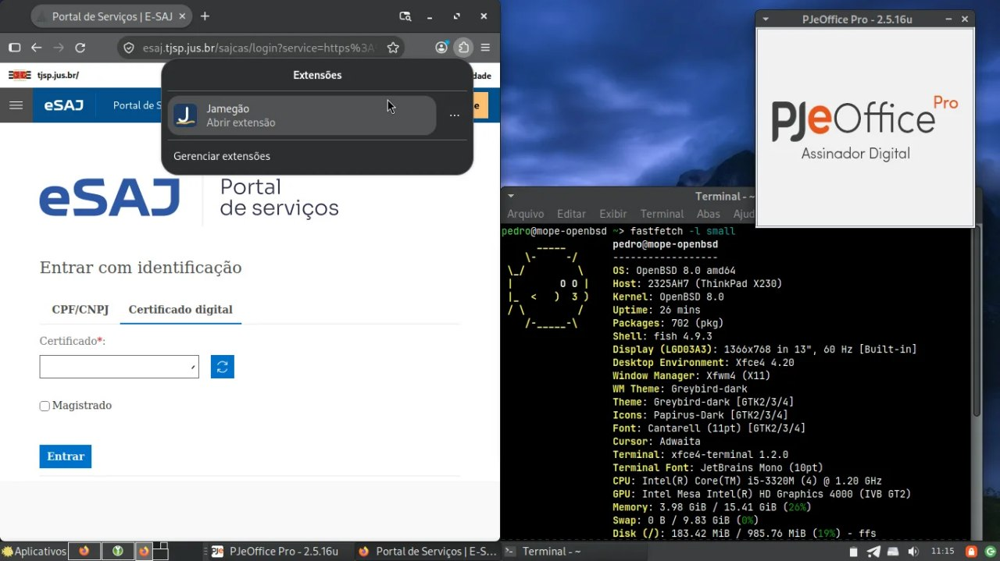

# openbsd-x230

Scripts que transformam uma instalação nova do **OpenBSD 8.0** num desktop **Xfce** pronto para o dia a dia no **ThinkPad X230**, inclusive com o PJeOffice Pro do CNJ.



No OpenBSD não basta uma lista de pacotes: além de instalar os programas, é preciso configurar o sistema e a sessão gráfica. O script principal faz as duas coisas. As listas de programas ficam dentro dele, por categoria e com a descrição de cada pacote. Elas seguem o `gnome.Brewfile` do repositório [brewfile](https://github.com/pedrohqb/brewfile) e os aplicativos que já vêm no Bluefin, com equivalentes para o que não existe no OpenBSD.

## O que você vai precisar

- Um ThinkPad X230 (ou outro notebook; veja [Hardware](#hardware)).
- Um pendrive para o instalador.
- Um **cabo de rede**: o firmware do Wi-Fi e do vídeo é baixado no primeiro boot.
- Cerca de uma hora: a instalação é rápida, e o script leva a maior parte do tempo baixando pacotes.

## Passo a passo

### 1. Instale o OpenBSD

1. Baixe o `install80.img` em [openbsd.org](https://www.openbsd.org/faq/faq4.html#Download).
2. Grave-o no pendrive com `dd`. O OpenBSD **não inicia pelo Ventoy**. No Linux, troque `sdX` pelo pendrive (confira com `lsblk`; o `dd` apaga tudo nele):
   ```sh
   sudo dd if=install80.img of=/dev/sdX bs=4M status=progress
   ```
3. Inicie o X230 pelo pendrive, com o **cabo de rede ligado**, e instale:
   - teclado `us`;
   - **todos os conjuntos**, inclusive os do X (`x*`);
   - crie o seu usuário quando o instalador perguntar.

### 2. Ajuste o script

Baixe o repositório, ainda como root (`su -`), porque o `doas` só fica pronto depois do script:

```sh
pkg_add git
git clone https://github.com/pedrohqb/openbsd-x230.git
```

Abra o `openbsd-x230/openbsd-x230.sh` e revise os **ajustes rápidos**, logo no topo. O padrão é o usado no X230:

| Opção | Padrão | O que muda |
|---|---|---|
| `LAYOUT` | `xfce` | `xfce`: um painel só, embaixo, com o Whisker Menu. `gnome`: barra superior, dock e janelas só com o botão de fechar |
| `GTK_THEME`, `ICON_THEME` | `Greybird-dark`, `Papirus-Dark` | Tema das janelas e dos ícones |
| `UI_FONT`, `MONO_FONT` | `Cantarell 11`, `JetBrains Mono 10` | Fonte da interface e do terminal |
| `IDIOMA` | `pt_BR.UTF-8` | Idioma da sessão gráfica |
| `XKB_LAYOUT`, `XKB_VARIANT` | `us`, `intl` | Teclado inglês internacional, com acentos (`'` + `c` = `ç`) |
| `TRACKPOINT_SCROLL` | `sim` | Rolar segurando o botão do meio do TrackPoint |
| `LOGIN_BG` | `#241f31` | Cor de fundo da tela de login |
| `TERMINAL_SHELL` | `/usr/local/bin/fish` | Shell do Terminal do Xfce (vazio: o ksh) |
| `HYPERTHREADING` | `nao` | `sim` usa os 4 threads, mas abre espaço para ataques de canal lateral entre programas; o OpenBSD desliga por segurança |
| `MIC_CAMERA` | `sim` | Libera microfone e câmera para videochamadas; `nao` mantém o padrão do OpenBSD (silêncio e imagem preta) |
| `CACHE_DISCO` | `40` | % da RAM para cache de arquivos (padrão do OpenBSD: 20) |
| `WIFI_SSID`, `WIFI_SENHA` | vazios | Rede Wi-Fi de casa (vazio: não configura) |
| `WEBAPP_BROWSER` | `chrome` | Navegador dos atalhos de aplicativos web |
| `DISCOS_INTERNOS` | `/dev/sd0* /dev/sd1* /dev/sd2*` | Discos que o botão de montar do painel não lista (no X230: os dois SSDs e o volume criptografado) |

Nas listas de pacotes, mais abaixo, comente com `#` o que não quiser instalar.

> **Cuidado com a senha do Wi-Fi:** depois de rodar o script, apague-a do arquivo e nunca a envie para o repositório.

### 3. Rode a pós-instalação

Ainda como root, troque `pedro` pelo seu usuário e reinicie no fim:

```sh
sh openbsd-x230/openbsd-x230.sh pedro
reboot
```

O script aplica as correções de segurança (`syspatch`) e o firmware (`fw_update`), instala os pacotes e configura o sistema e a sessão (a lista completa está em [O que o script configura](#o-que-o-script-configura)). No fim, ele mostra os pacotes que não conseguiu instalar e os próximos passos.

Pode rodá-lo de novo quando quiser: ele pula o que já está instalado e guarda uma cópia `.orig` de cada arquivo de configuração antes da primeira alteração. Se a sessão do Xfce estiver aberta, saia dela antes, para o Xfce não sobrescrever o que o script grava.

### 4. Termine a configuração

Depois de reiniciar, a tela de login gráfica abre sozinha. Faltam três ajustes manuais:

1. **Pendrive no painel.** O botão de montar só lista o que está no `/etc/fstab`. Conecte o pendrive, veja o nome dele com `dmesg | tail` (por exemplo `sd3`, depois dos discos internos e do volume criptografado) e acrescente ao `/etc/fstab`:
   ```
   /dev/sd3i /home/pedro/usb msdos rw,noauto,nodev,nosuid 0 0
   ```
   Feche a janela do Thunar na pasta antes de desmontar.
2. **OneDrive.** O `onedrive-cli` não existe para OpenBSD: rode `rclone config` e escolha "Microsoft OneDrive".
3. **Token ePass2003 no Firefox.** Em Configurações > Privacidade e Segurança > Dispositivos de segurança > Carregar, indique `/usr/local/lib/pkcs11/opensc-pkcs11.so`.

### 5. Confira a instalação

Com o seu usuário, sem `doas`:

```sh
sh openbsd-x230/revisao-openbsd.sh
```

A revisão confere pacotes, serviços, ajustes e arquivos de configuração, sem alterar nada, e termina com `Resultado: N itens certos, 0 faltando` quando está tudo em ordem.

### 6. PJeOffice Pro (opcional)

Com o seu usuário; o script só pede a senha do `doas` para instalar o JDK 11:

```sh
sh openbsd-x230/pjeoffice-openbsd.sh
```

O PJeOffice Pro fica em `~/.local/share/pjeoffice-pro`, com atalho no menu. Para usar o **token ePass2003**, na configuração de certificado do PJeOffice, aba A3, indique o caminho completo `~/.local/share/pjeoffice-pro/opensc-java.so` (e não o `opensc-pkcs11.so`). Fechar a janela encerra o programa.

O que funciona no OpenBSD 8.0:

- login no PJe e assinatura com **certificado A1** (arquivo `.pfx`) e com o **token ePass2003** (login no PJe testado);
- as funções de vídeo que só dependem do `ffmpeg`: dividir por tamanho e por duração e extrair áudio (testadas); converter e otimizar usam o mesmo caminho.

O que não funciona: o **corte por trechos**, que abre um player dependente do JavaFX, e o OpenBSD 8.0 não tem o pacote `openjfx`. O script deixa um aviso com alternativas; uma delas é cortar pelo terminal:

```sh
ffmpeg -i video.mp4 -ss 00:01:30 -to 00:04:00 -c copy trecho.mp4
```

<details>
<summary>Como o script faz o PJeOffice rodar no OpenBSD</summary>

O PJeOffice Pro é um programa Java, e o CNJ só o distribui para Linux, Windows e macOS. O script baixa o `.zip` de Linux do site do CNJ, confere a soma SHA256, descarta o Java embutido e o `ffmpeg` (que são para Linux) e roda o `pjeoffice-pro.jar`, sem alteração, no JDK 11 e com o `ffmpeg` do OpenBSD.

- **Janela como no GNOME e no KDE:** `-Dpjeoffice_desktop=true` pede o modo de janela, em vez do modo bandeja. Além disso, `--patch-module` troca, só para o PJeOffice, a classe `java.awt.SystemTray` por um substituto que responde "não há bandeja". Sem isso, no Xfce a janela se recolhe para a bandeja ao ser fechada ou minimizada, e o menu da bandeja aparece em branco. O substituto é compilado na instalação e fica em `sem-bandeja/`.
- **Vídeo:** o PJeOffice procura um `ffmpeg` externo na pasta do programa, com o nome `ffmpeg.exe`. O script troca o binário de Linux por um atalho para `/usr/local/bin/ffmpeg`.
- **Token:** o OpenSC informa que as chaves RSA assinam e decifram sem cifrar, o Java 11 descarta um mecanismo informado assim, e a assinatura falha com `is not a RSAPrivateKey instance`. O script compila o `opensc-java.c`, uma biblioteca que carrega o OpenSC e só acrescenta essa marca.

</details>

### 7. Webcam no Chromium (opcional)

Com o kernel padrão do OpenBSD 8.0, a webcam funciona no Firefox e no comando `video`, mas no Chromium fica preta. Para ela funcionar também no Chromium (e nos atalhos do Teams e do Zoom), instale um kernel com a correção:

```sh
doas sh openbsd-x230/kernel-video-brad.sh
doas reboot
```

O script leva uns 40 minutos: baixa o código do kernel do 8.0, aplica todas as correções oficiais (errata) e o diff do Brad Smith, compila e instala. Se algo não encaixar, ele para sem instalar nada.

- **Para voltar ao kernel anterior:** `doas cp /obsd /bsd` e reinicie.
- **Depois de um `syspatch` que traga correção de kernel**, o kernel padrão volta por cima. Rode o script de novo, apagando antes o código anterior: `doas rm -rf /usr/src/sys`.
- **Se preferir ficar com o kernel padrão**, troque `app` por `firefox` no Teams e no Zoom, na lista `WEBAPPS` do script, para eles abrirem no Firefox.

<details>
<summary>Por que a webcam fica preta no Chromium</summary>

Se o primeiro quadro não chega em 1 segundo, o Chromium reinicia a captura, e para isso pede ao driver que libere os buffers de vídeo (`VIDIOC_REQBUFS(0)`). O `uvideo(4)` do OpenBSD 8.0 recusa esse pedido, e o Chromium encerra a sessão. O [diff do Brad Smith na tech@](https://marc.info/?l=openbsd-tech&m=179513475544929&w=2) faz o driver aceitar o pedido. O script do kernel é necessário até essa correção entrar no OpenBSD.

</details>

## O que o script configura

- **Sistema:** `syspatch`, `fw_update`, `doas` para o grupo `wheel`, grupo `_shutdown` (desligar pelo menu) e classe de login `desktop`, com limite de memória por processo de metade da RAM.
- **Energia e desempenho:** `apmd -A` (frequência automática e suspensão com 7% de bateria), suspensão ao fechar a tampa, tela bloqueada ao voltar da suspensão (pelo `/etc/apm/suspend`, para a tampa, e pela opção do Xfce, para o botão), janela de saída sem o botão de hibernar (o swap padrão é menor que a RAM), escurecimento e desligamento da tela na bateria, `noatime`, cache de disco em 40% da RAM e Hyper-Threading desligado.
- **Entrada:** teclado inglês internacional com teclas mortas na sessão gráfica, rolagem com o botão do meio do TrackPoint e toque para clicar no touchpad.
- **Janelas:** encaixe nas bordas e nos cantos ao arrastar, Super+setas para metades, maximizar e minimizar, e Super+Espaço para abrir o menu.
- **Aparência:** tema Greybird escuro, ícones Papirus, fontes Cantarell e JetBrains Mono, tela de login sem o console e sem bipe. O painel é uma barra única embaixo, com o Whisker Menu (logo do OpenBSD e favoritos), áreas de trabalho, janelas agrupadas, bandeja, botão de montar, volume, relógio e um botão com bloquear e sair. Com `LAYOUT="gnome"`, vira uma barra superior com dock.
- **Terminal:** o Terminal do Xfce abre o fish; o shell de login (console, SSH e root) continua sendo o ksh, com histórico e autocompletar no `~/.kshrc`.
- **Aplicativos web:** atalhos para ChatGPT, Claude, Discord, Gemini, Teams, WhatsApp, YouTube Music e Zoom, porque esses serviços não têm cliente para OpenBSD (o YouTube Music entra no lugar do Spotify). Abrem no Chromium, em janela própria.
- **Microfone e webcam:** gravação de áudio e de vídeo liberada no sistema, e a webcam entregue ao usuário a cada login gráfico.
- **Discos externos:** `doas mount` e `doas umount` sem senha só para `~/usb`, mais o botão de montar do painel. Uma regra sem senha para qualquer `mount` equivaleria a root sem senha. Discos NTFS (`ntfs-3g`) pedem a senha.

## Dicas de uso

- **VPN WireGuard:** o WireGuard faz parte do sistema, e o pacote `wireguard-tools` traz o `wg-quick`, que usa o mesmo arquivo `.conf` do Linux. Guarde-o como `/etc/wireguard/wg0.conf`, com dono `root` e permissão `600`. Para ligar e desligar: `doas wg-quick up wg0` e `doas wg-quick down wg0`; `doas wg show` mostra se o túnel subiu.
- **Pastas de rede (Samba):** o Thunar abre `smb://servidor/pasta` (Ctrl+L para digitar o endereço). Pela VPN, use o endereço IP do servidor. Se o endereço ficar vermelho logo depois de instalar, saia e entre na sessão.
- **Impressora de rede:** o OpenBSD não resolve nomes `.local` (mDNS), e não há equivalente ao `nss-mdns` do Linux. O CUPS encontra a impressora na busca, mas falha ao imprimir com "Não foi possível localizar a impressora". Reserve o IP dela no roteador e registre o nome no `/etc/hosts`, por exemplo `192.168.3.34 BRWAC50DE54C6E4.local BRWAC50DE54C6E4`. O endereço físico está no próprio nome (`BRW` + MAC), e `arp -an` mostra o IP atual. O script já instala o `brlaser`, driver das lasers monocromáticas da Brother.
- **e-SAJ:** o WebSigner e o Web PKI não existem para OpenBSD. A extensão [Jamegão](https://github.com/pedrohqb/jamegao) faz o papel deles no Firefox, sem componente nativo; funciona com certificado A1 (arquivo PFX), não com token.
- **Evolution:** o `gnome-keyring` guarda as senhas e sobe com a sessão; sem PAM, o cofre pede a senha uma vez por sessão. Se uma conta do Exchange listar as pastas mas responder "Pasta inexistente" ao abrir, feche o programa e apague o cache: `evolution --force-shutdown; rm -rf ~/.cache/evolution/mail`.
- **Wi-Fi do trabalho:** o OpenBSD guarda várias redes e entra sozinho na que estiver ao alcance. Acrescente uma linha `join "NomeDaRede" wpakey "senha"` ao `/etc/hostname.iwm0`, antes das linhas `inet`, e aplique com `doas sh /etc/netstart iwm0`.
- **Pacotes com variantes ou várias versões:** o `pkg_add` pergunta qual instalar. Nas listas do script, `nome--variante` escolhe a variante (por exemplo `keepassxc--browser`) e `nome->=N` escolhe a versão (por exemplo `gimp->=3`).

## Limitações conhecidas

- **Sem equivalente no OpenBSD 8.0:** Claude Code, Antigravity CLI (`agy`; no lugar dele, o atalho do Gemini), ONLYOFFICE, PDFsam Basic, BibleTime, Wine, Tessera e os drivers SafeNet, SafeSign e SerproID, que dependem de Linux. O PJeOffice Pro roda pelo script próprio ([passo 6](#6-pjeoffice-pro-opcional)), e o token ePass2003 funciona pelo OpenSC.
- **Spotify:** não há cliente que funcione. O player web não toca, por falta do componente de proteção de conteúdo nos navegadores; o `spotify-qt` depende do `librespot`, que não está nos pacotes; e o `ncspot` 1.4.0 não completa o login, porque o aplicativo dele no Spotify passou a exigir outro endereço de retorno (`/ncspot_login`), o que só a versão 1.5.0 atende. O atalho do YouTube Music ocupa o lugar.
- **Tecla de mutar o microfone:** o driver do ThinkPad no OpenBSD não a repassa, e ela não faz nada. Para mutar e desmutar: `sndioctl -q input.mute=!` (dá para associar a um atalho em Configurações > Teclado).
- **Snapshot (Câmera do GNOME):** não roda, por depender do PipeWire.
- **Corte de vídeo do PJeOffice:** depende do JavaFX, que não existe no OpenBSD 8.0 (veja o [passo 6](#6-pjeoffice-pro-opcional)).

## Hardware

O script foi feito e testado num ThinkPad X230 com a placa Wi-Fi Intel trocada (driver `iwm`). A placa sem fio é detectada pelo sistema, não pelo nome; o que é próprio do X230 são a rolagem do TrackPoint, os discos de `DISCOS_INTERNOS` e, no script de revisão, o nome `iwm0` e os 2 threads esperados.

## Arquivos do repositório

| Arquivo | O que faz |
|---|---|
| `openbsd-x230.sh` | Pós-instalação: correções e firmware, pacotes, serviços, energia, desempenho, Wi-Fi, teclado, TrackPoint, tela de login, aparência do Xfce, terminal e atalhos de aplicativos web |
| `revisao-openbsd.sh` | Revisão: confere pacotes, serviços, ajustes e arquivos de configuração, sem alterar nada, e lista o que falta |
| `pjeoffice-openbsd.sh` | Instala o PJeOffice Pro do CNJ na pasta pessoal, rodando no JDK 11 do OpenBSD |
| `opensc-java.c` | Biblioteca que o script do PJeOffice compila para o Java assinar com token do OpenSC |
| `kernel-video-brad.sh` | Monta e instala um kernel do 8.0 com as errata oficiais e o diff do Brad Smith, para a webcam funcionar no Chromium |

## Licença

[CC0 1.0 Universal](LICENSE): domínio público. Use à vontade.
